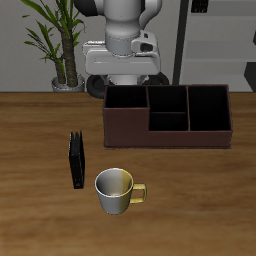

# Chat to compatible robot skills

DVIDIA research · 27 October 2026 · Product architecture and local runtime note

The intended interface is a conversation: attach a photo, describe a desired
outcome, and let DVIDIA find an executable skill for the available robot. The
conversation should carry the workflow from observation through installation,
simulation and review. A user should not need to assemble those tools manually.

The current prototype connects photo analysis and conservative skill retrieval
to a separate local worker for ten LIBERO-10 task descriptions sharing one
revision-pinned OpenVLA checkpoint. **Real local object detection and one native
simulator reset are verified. OpenVLA model inference, learned robot actions and
activation-steered robot actions have not been executed.** The checkpoint
transfer stopped after an 8 MiB partial download; this is not an installation or
a successful task. The [runtime receipt](../topics/physical-grounding/runs/2026-10-27-robot-lab/runtime-receipt.json)
and [evidence notes](../topics/physical-grounding/runs/2026-10-27-robot-lab/README.md)
preserve that boundary. A companion [Hugging Face concept card](https://huggingface.co/spaces/Dvidia/robot-simulation-lab/blob/main/docs/robot-chat-v01/concept.md)
tracks the same documentation scope; it does not host OpenVLA inference.

## One conversation carries the task

A useful request is “Put the book in the back compartment of the caddy,” with a
photo attached. DVIDIA needs to identify the intended object and destination,
look for a compatible behavior, check its prerequisites and expose any missing
evidence. The product should present these as progress in one conversation:

| Conversation event | What it represents |
| --- | --- |
| Photo and desired outcome | User input, including explicit corrections |
| “I found a book; please identify its destination” | A grounded question when the evidence is insufficient |
| Skill card with prerequisites and compatibility | A candidate, with reasons it can or cannot run |
| Download progress and verified installation | Actual artifact state, including interruption and retry |
| Simulator preview and run progress | A real task reset followed by actual policy actions when available |
| Outcome and inspectable trace | Success, failure or cancellation with actions and observations |
| “Try this intervention” | An experimental rerun with the same initial simulator state |

This is the proposed simplification of the current staged Robot lab interface.
Detailed connection settings, manifests, action vectors and channel controls can
live in expandable cards. The conversation remains an interface to typed tools;
assistant prose cannot mark an artifact installed or a task completed.

“Tidy this room” expresses a valid desired outcome but leaves important
decisions unresolved: where toys belong, which clothes are dirty, whether a
container is reachable and whether the robot has the required behaviors. A photo
does not answer all of these questions. The first version should ask for missing
destinations or state evidence and report unsupported tasks. General household
task decomposition and automatic selection of multi-skill sequences are future
work. No dishwashing, laundry or toy-sorting competence is established by this
prototype.

## Retrieve by intended change, then check compatibility

The architecture connects five distinct decisions:

```text
Photo + desired outcome
    -> observations with source and uncertainty
    -> candidate skills with prerequisites and effects
    -> compatible artifact + verified installation
    -> actual simulator state + policy execution
    -> measured outcome + inspectable trace
```

An object name is a useful search clue, but the intended change determines
whether a skill is relevant. A mug-placement task does not satisfy a request to
wash a mug. A drawer task that closes the drawer adds an unwanted effect if the
user asked for it to remain open. The current browser planner uses bounded
lexical matching and aliases; it checks object identities, destinations,
relations, state changes and negation, then rejects incompatible profiles. It is
not a learned affordance estimator or a general language planner.

This separation is motivated by [SayCan](https://say-can.github.io/), which
combines language-based skill relevance with state-dependent affordances. Our
current rule-based filter does not reproduce SayCan's learned value functions
or its reported performance. The design implication is to keep goal relevance,
observed prerequisites and runtime compatibility independently inspectable.

Every executable candidate currently carries a skill ID, instruction, required
objects, effects, prerequisites, profile ID, checkpoint repository, immutable
revision and benchmark task ID. The present profile is
`libero-panda-openvla-v1`: a Franka Panda simulation using seven-dimensional OSC
pose actions. Its checkpoint is
[`openvla/openvla-7b-finetuned-libero-10`](https://huggingface.co/openvla/openvla-7b-finetuned-libero-10/tree/80970322773f81baa2e22fe495d0487b93a05cfa).
The ten task entries share the same checkpoint; downloading each task does not
create ten separate learned policies.

The [example v1 manifest](../topics/physical-grounding/runs/2026-10-27-robot-lab/skill-manifest.example.json)
is documentation only and contains no installed artifact.

A broader skill registry will also need versioned observation and action
schemas, units, control rate, gripper convention, tested operating envelope,
required sensors, adapter versions and task-specific evaluation receipts.
Hardware compatibility would require its own tested adapter and qualification.
Those extended registry fields are a proposed contract, not an implemented
universal skill package.

## Execution belongs to the local worker

The browser communicates with an isolated loopback worker using the typed
`dvidia.robot-lab.v1` protocol and an in-memory capability. The worker performs
real detector calls, artifact verification, native resets, model loading and
bounded runs. It contains no physical robot driver. Checkpoint size, revision
and digests are verified before atomic activation; partial files never count as
an installed skill. The runtime loads explicit classes from pinned OpenVLA
source rather than executing a checkpoint's remote class mapping.

An arbitrary household photo is planning input. It is not an executable LIBERO
state. Before a run, the user must select a supported benchmark task and capture
its real simulator camera and initial state. Task metadata is marked as
simulator evidence, distinct from image detections and user corrections. A run
is bound to that task, scene, seed and installed checkpoint. Completion must
come from the simulator's task-success signal.

[OpenVLA](https://github.com/openvla/openvla) supplies a language-conditioned
robot action policy. The selected [checkpoint card](https://huggingface.co/openvla/openvla-7b-finetuned-libero-10)
describes a LIBERO-10 fine-tune; it is a concrete starting point for this
benchmark-specific experiment, not a generally installable housekeeping model.
The runtime uses `predict_action` with the `libero_10` normalization statistics.
Code, checkpoint and underlying model terms need separate review; the upstream
MIT labels do not replace the applicable Llama 2 terms or third-party asset
licenses.

## What has actually run

The retained receipt was recorded on 26 October 2026 and is published here as a
historical engineering result. It is not a fresh benchmark of this note's date.

| Component | Recorded evidence | Limit |
| --- | --- | --- |
| Local runtime | Python 3.12.9, Torch 2.6.0 and MPS detected on an Apple Silicon Mac | Full OpenVLA memory fit and latency unverified |
| Real photo inference | Verified TorchVision SSDlite checkpoint; cup 0.9957, person 0.8254 and dining table 0.4730 on one editorial image | Confidence scores are detector outputs, not measured accuracy; no dirt, color, ownership or task-state judgment |
| Native task reset | LIBERO-10 task 5, seed 7, book/caddy camera image and flattened-state digest | Zero policy actions; ten no-op settling steps only |
| Reset repeatability | Worker-thread and independent main-thread reset digests match | Matching initial state does not establish deterministic inference or rollouts |
| Artifact installation | Interrupted transfer retained 8 MiB of a roughly 15.1 GB checkpoint | No activated checkpoint |
| Policy and steering | Transport and hook fixtures tested | No learned rollout, task result or behavioral steering measurement |

The reset digest is
`b133849e34e709aaecf9f42e1a281d9dc53dfeeebf01d5e41077914b8d12893e`.
The macOS worker uses MuJoCo's official offscreen CGL context to avoid initializing
GLFW/AppKit from an HTTP worker thread. This changes context selection, not the
physics or observed state. Only the task-5 asset closure was provisioned for the
recorded runtime check; other task assets remain locally unverified.



The photograph used for detector testing was an editorial illustration from the
app, not a physical robot camera capture. The simulator image above is an actual
rendered reset. Neither is evidence that a robot performed the requested action.

## Neuron exploration is a separate measured intervention

[Lyra's neuron explorer](https://github.com/lyramakesmusic/neuron-explorer)
inspired the interaction: inspect model units, change a unit's activation and
retain the resulting behavior. Its text-model experiments do not by themselves
establish a robot control method. The directly relevant robotics precedent is
[Mechanistic Interpretability for Steering Vision Language Action Models](https://vla-mech-interp.github.io/),
which studies semantic activation directions and interventions in OpenVLA and
π₀. Its [research code](https://github.com/Physical-AI-Safety-Institute/mechanistic-steering-vlas)
is a methodological reference; the DVIDIA worker uses an original hook and does
not vendor that toolkit.

The implemented hook observes a zero-based intermediate Llama MLP channel at the
input to `down_proj`. It records the last token's value on each autoregressive
forward pass and can add a bounded raw dose to that channel. The displayed
per-action value averages the pre-intervention values across generation passes.
This is **a raw channel intervention**, not an identified “careful,” “fast” or
“move left” neuron. It is also not an implementation-equivalent reproduction of
the paper's semantic cluster interventions. Hook cleanup and cancellation have
unit coverage; their effects on a loaded robot policy remain unmeasured.

Before behavioral claims, compare an unsteered baseline and intervention on the
same checkpoint, task, seed, preprocessing and exact reset digest. Record all
action dimensions, end-effector motion, activation summaries, cameras,
completion and failures. Current portable Pillow preprocessing is explicitly a
numerical variant of upstream's TensorFlow path, so published OpenVLA benchmark
scores are not a performance reference for this Mac configuration.

## Staged evaluation and release gates

1. **Conversation and retrieval:** freeze a small set of supported and
   unsupported requests, including ambiguous destinations, negation and desired
   state changes. Independently label compatible candidates. Report retrieval
   precision and recall, unsupported-task handling and clarification behavior.
   An interaction that looks correct is not evidence of execution.
2. **Installation and one-action diagnostic:** finish the revision-pinned
   transfer, verify every artifact, load the full model and execute one real
   action on the recorded task-5 reset. Record peak memory, load/inference time,
   actual action vector and failure status. Stop if memory or rendering is
   insufficient; a substitute controller does not satisfy this gate.
3. **Baseline simulation:** run bounded unsteered episodes on a frozen set of
   seeds. Retain every attempt and the actual LIBERO success signal. Report
   strict completion, step counts, latency and invalid attempts separately.
4. **Causal channel study:** choose units and doses using development scenes,
   then freeze them. Compare paired baseline, sham-hook, positive/negative-dose
   and randomly selected channel controls on held-out seeds. Measure task
   completion alongside motion changes; do not select only successful videos.
5. **Skill sequencing and household transfer:** introduce separately qualified
   skills, evidence refresh after each action, explicit recovery and destination
   rules. Hardware execution needs independent adapter, sensing and task
   qualification. This stage is not implemented or run.

Stages 2–5 remain unrun. The first deliverable is an honest conversation that
connects to real tools and makes missing capability understandable. The research
question is whether that interface can select a skill whose measured behavior
achieves the user's intended change, and whether controlled interventions alter
that behavior reproducibly without degrading completion.
